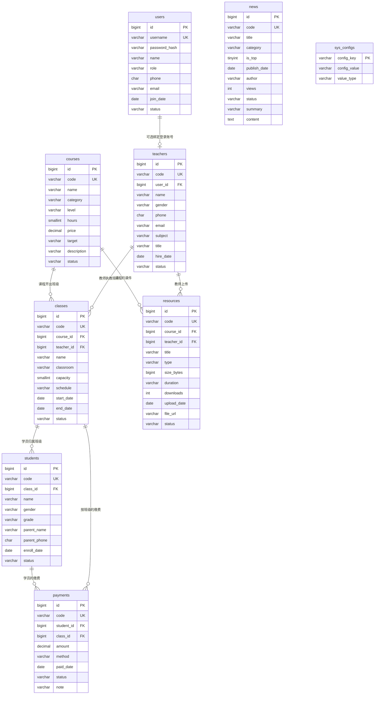

# 启航编程管理系统 · 数据库设计文档

> 设计依据：项目 `web/` 目录下的前端原型（第一阶段·静态演示版 v0.2，12 个管理页面，数据硬编码于 `web/js/data.js` 并经 localStorage 持久化）。本文档将原型中的数据结构逆向归纳为关系模型，作为后端数据库（MySQL 8.0）的落地设计依据。

| 项目 | 内容 |
| --- | --- |
| 文档版本 | v1.0 |
| 更新日期 | 2026-10-08 |
| 目标数据库 | MySQL 8.0+（InnoDB · utf8mb4_0900_ai_ci） |
| 核心表数量 | 9 张（另含 2 张扩展建议表） |
| 文档状态 | 初稿 · 待评审 |

## 目录

1. [概述](#1-概述)
2. [设计约定](#2-设计约定)
3. [数据模型总览（ER 图）](#3-数据模型总览)
4. [枚举字典](#4-枚举字典)
5. [表结构详细设计](#5-表结构详细设计)
6. [引用完整性与删除保护策略](#6-引用完整性与删除保护策略)
7. [状态机设计](#7-状态机设计)
8. [典型查询与统计口径](#8-典型查询与统计口径)
9. [数据库初始化与种子数据](#9-数据库初始化与种子数据)
10. [安全与运维要点](#10-安全与运维要点)
11. [演进建议](#11-演进建议)
12. [变更记录](#12-变更记录)

---

## 1. 概述

### 1.1 设计目的

- 将前端原型的 localStorage 数据结构（`DEFAULT_DB` 对象）转化为规范的第三范式（3NF）关系模型；
- 明确字段类型、约束、索引与外键策略，后端可直接按本文档建表；
- 固化原型中隐含的业务规则（删除保护、状态流转、统计口径），作为后端服务层校验与测试用例的依据。

### 1.2 系统现状与实体映射

| 前端页面 | 数据实体 | 主要操作（来自原型） |
| --- | --- | --- |
| `login.html` 登录 | users | 账号密码校验；禁用账号拒绝登录 |
| `dashboard.html` 工作台 | 跨表聚合 | 只读统计：在读学员、在职教师、进行中班级、本月/累计收入、班级报名热度、近期开班、最近缴费 |
| `users.html` 用户管理 | users | 增删改、角色分配、启用/禁用、重置密码（仅超级管理员可见） |
| `teachers.html` 教师管理 | teachers | 增删改、搜索筛选（姓名/工号/电话、科目、状态） |
| `courses.html` 课程管理 | courses | 增删改、上架/停售切换 |
| `classes.html` 班级管理 | classes | 排班（关联在售课程 + 在职教师）、报名进度、删除保护 |
| `students.html` 学生管理 | students | 报名（必须归属一个未结课班级）、编辑、删除（级联删除缴费记录） |
| `payments.html` 缴费管理 | payments | 登记、确认到账、作废、编辑、三卡片统计 |
| `news.html` 新闻中心 | news | 发布、置顶、草稿、阅读计数、详情查看 |
| `resources.html` 课件资源 | resources | 上传（模拟）、编辑、下载计数、删除 |
| `profile.html` 个人信息 | users（当前会话） | 修改姓名/手机/邮箱、修改密码 |
| `settings.html` 系统设置 | sys_configs | 机构信息维护、业务开关、新学员默认状态 |

### 1.3 读者与使用方式

- **后端开发**：按第 5、9 章建表与初始化；按第 6、7 章实现服务层校验；
- **前端开发**：第 4 章枚举值与第 8 章统计口径与页面一一对应；
- **测试**：第 6、7 章的业务规则可直接转化为测试用例。

---

## 2. 设计约定

### 2.1 环境与选型

| 项 | 约定 | 说明 |
| --- | --- | --- |
| 数据库 | MySQL 8.0+ | 与 Python 3.12 后端工程（`pyproject.toml`）配套 |
| 存储引擎 | InnoDB | 支持事务、行锁、外键 |
| 字符集 | utf8mb4（排序规则 utf8mb4_0900_ai_ci） | 兼容中文与 emoji |
| 库名 | `training_platform` | 建库语句见第 9 章 |

### 2.2 命名规范

- 表名：小写蛇形、**复数**（`users`、`teachers`、`classes`…），同时避开 MySQL 保留字（如单数 `user` 是保留字）；
- 列名：小写蛇形；布尔列以 `is_` 开头；
- 主键：统一 `id BIGINT UNSIGNED AUTO_INCREMENT`；
- 约束/索引前缀：唯一键 `uk_`、普通索引 `idx_`、外键 `fk_`、检查约束 `chk_`。

### 2.3 主键与业务编号（双列策略）

原型以业务编号（`XS001`、`KC001`、`JF001`…，规则为「前缀 + 3 位序号」）作为主键并直接展示在界面。本设计拆分为两列：

- **`id`**：数据库内部自增主键，用于外键关联，索引性能最优；
- **`code`**：业务编号，`UNIQUE` 唯一索引，面向用户展示，完整保留原型的编号习惯。

| 实体 | 编号前缀 | 示例 | 原型字段 |
| --- | --- | --- | --- |
| 用户 | —（使用 username 登录） | admin | `users.username` |
| 教师 | JS | JS001 | `teachers.id` |
| 课程 | KC | KC001 | `courses.id` |
| 班级 | BJ | BJ001 | `classes.id` |
| 学员 | XS | XS001 | `students.id` |
| 缴费 | JF | JF001 | `payments.id` |
| 新闻 | XW | XW001 | `news.id` |
| 资源 | ZY | ZY001 | `resources.id` |

> ⚠️ **编号生成与并发**：原型 `nextId()` 的「取当前最大序号 + 1」在并发下可能重号。后端实现必须在事务内取号，并依赖 `uk_code` 唯一索引兜底（插入冲突时重试）。

### 2.4 通用审计列

| 列 | 类型 | 说明 |
| --- | --- | --- |
| `created_at` | DATETIME | `DEFAULT CURRENT_TIMESTAMP` |
| `updated_at` | DATETIME | `ON UPDATE CURRENT_TIMESTAMP` |
| `deleted_at` | DATETIME NULL | 软删除标记（原型为物理删除，后端升级为软删除，见 6.3） |

所有业务查询默认追加 `deleted_at IS NULL`（建议由 ORM Base 模型统一注入，避免遗漏）。

### 2.5 类型与约束约定

| 场景 | 约定 | 备注 |
| --- | --- | --- |
| 金额 | `DECIMAL(10,2)`，单位：元 | 演示数据中的整数金额是巧合（存在 2400 / 1200 / 600 等） |
| 手机号 | `CHAR(11)` | 应用层正则 `^\d{11}$`，与原型校验一致 |
| 日期 / 时间 | 业务日期 `DATE`，系统时间 `DATETIME` | 原型日期均为 `YYYY-MM-DD` 字符串 |
| 枚举 | `VARCHAR + CHECK` 约束 + 应用层枚举 | 不用 MySQL `ENUM` 类型（增删值需改表结构，迁移不灵活） |
| 密码 | `password_hash VARCHAR(100)`，bcrypt | 原型明文密码仅限前端演示，**数据库绝不存明文** |
| 布尔 | `is_xxx TINYINT(1)` | 如 `news.is_top` |


---

## 3. 数据模型总览

### 3.1 ER 图



### 3.2 关系说明

| 关系 | 基数 | 业务约束（来自原型） |
| --- | --- | --- |
| courses → classes | 1:N | 仅「在售」课程可参与排班（`classes.js fillSelects`） |
| teachers → classes | 1:N | 排班时仅列「在职」教师 |
| classes → students | 1:N | **学员归属单一班级**（原型单班制；多班/续报场景见 11.1 演进） |
| students、classes → payments | 1:N | 一笔缴费同时关联学员与班级；登记时选学员自动带出其班级、选班级自动带出课程价格（可改） |
| courses、teachers → resources | 1:N | 课件归属课程并记录上传教师（须为在职教师） |
| users → teachers | 1:0..1 | 教师可绑定一个登录账号（原型中账号 `wangzq` 对应教师「王志强」，两者邮箱一致） |
| news | 独立表 | `author` 为自由文本（默认当前登录用户姓名），不做强外键 |

### 3.3 表清单与量级预估

| # | 表名 | 中文名 | 预估量级（单校区/年） | 对应原型数据 |
| --- | --- | --- | --- | --- |
| 1 | `users` | 系统用户（登录账号） | < 100 | `DEFAULT_DB.users` |
| 2 | `teachers` | 教师 | < 100 | `DEFAULT_DB.teachers` |
| 3 | `courses` | 课程 | < 100 | `DEFAULT_DB.courses` |
| 4 | `classes` | 班级 | 100 ~ 500 | `DEFAULT_DB.classes` |
| 5 | `students` | 学员 | 1,000 ~ 5,000 | `DEFAULT_DB.students` |
| 6 | `payments` | 缴费记录 | 5,000+ | `DEFAULT_DB.payments` |
| 7 | `news` | 新闻资讯 | 100 ~ 1,000 | `DEFAULT_DB.news` |
| 8 | `resources` | 课件资源 | 500 ~ 5,000 | `DEFAULT_DB.resources` |
| 9 | `sys_configs` | 系统配置（键值） | < 50 | `DEFAULT_DB.org` + `DEFAULT_DB.settings` |
| 10 | `bills` | 应收账单（v1.1 新增） | 5,000+ | 无（家长端缴费详情引入） |

> 量级结论：全部为小表，索引 + 单机 MySQL 完全够用，无需分库分表；`payments` 增长最快，注意按 `paid_date` 保留索引即可。


---

## 4. 枚举字典

以下枚举值**全部提取自原型 HTML 的下拉选项与 `data.js` 演示数据**。数据库采用 `VARCHAR + CHECK` 约束落地，应用层以同名校验枚举双重保障。

### 4.1 通用枚举

| 枚举标识 | 取值 | 来源 |
| --- | --- | --- |
| `gender` 性别 | 男 / 女 | 各编辑表单（默认女） |
| `enable_status` 账号状态 | 启用 / 禁用 | `users.html` |
| `publish_status` 发布状态 | 已发布 / 草稿 | `news.html` / `resources.html` |

### 4.2 用户与教师

| 枚举标识 | 取值 | 来源 |
| --- | --- | --- |
| `user_role` 用户角色 | 超级管理员 / 教务管理员 / 财务专员 / 前台接待 / 教师 | `users.html`；原型中仅「超级管理员」可访问用户管理 |
| `teacher_subject` 主教科目 | Scratch / Python / C++ / 人工智能 / Web / 机器人 / Java | `teachers.html` |
| `teacher_title` 职称 | 助教 / 讲师 / 高级讲师 / 金牌竞赛教练 | `teachers.html`（默认讲师） |
| `teacher_status` 在职状态 | 在职 / 离职 | `teachers.html` |

### 4.3 课程与班级

| 枚举标识 | 取值 | 来源 |
| --- | --- | --- |
| `course_category` 课程分类 | Scratch / Python / C++ / 人工智能 / Web / 机器人 / Java / 其他 | `courses.html`（编辑表单比筛选多一项「其他」） |
| `course_level` 课程级别 | 启蒙 / 入门 / 进阶 / 竞赛 | `courses.html` |
| `course_status` 上架状态 | 在售 / 停售 | `courses.html`；仅「在售」可排班 |
| `class_status` 班级状态 | 未开班 / 进行中 / 已结课 | `classes.html`；学员分班下拉排除「已结课」 |
| `classroom` 教室 | A101 / A102 / B203 / C305 | 原型为固定下拉，暂存 `VARCHAR(20)`；建议演进为教室资源表（见 11.3） |

### 4.4 学员与缴费

| 枚举标识 | 取值 | 来源 |
| --- | --- | --- |
| `student_grade` 年级 | 一年级、二年级、三年级、四年级、五年级、六年级、初一、初二、初三、高一、高二、高三 | `students.html`（共 12 项） |
| `student_status` 学员状态 | 在读 / 休学 / 已结课 | `students.html`；新学员默认值由 `sys_configs.settings.newStudentStatus` 配置 |
| `payment_method` 缴费方式 | 微信 / 支付宝 / 现金 / 银行转账 | `payments.html` |
| `payment_status` 缴费状态 | 待确认 / 已支付 / 已退款 / 已作废 | `payments.html`；状态机见第 7 章 |

### 4.5 新闻与资源

| 枚举标识 | 取值 | 来源 |
| --- | --- | --- |
| `news_category` 新闻分类 | 机构动态 / 活动通知 / 比赛获奖 / 开班信息 | `news.html` |
| `resource_type` 资源类型 | 课件PPT / 教学视频 / 习题册 / 素材包 | `resources.html` |

### 4.6 系统配置键（`sys_configs` 初始键）

| config_key | value_type | 默认值（演示） | 含义 |
| --- | --- | --- | --- |
| `org.name` | string | 启航编程教育 | 机构名称 |
| `org.phone` | string | 0571-88886666 | 机构联系电话 |
| `org.address` | string | 杭州市西湖区文三路 100 号 启航大厦 3 楼 | 机构地址 |
| `org.intro` | string | 专注 6-18 岁青少年编程教育…… | 机构简介 |
| `settings.allowLeave` | bool | true | 允许学员自助请假 |
| `settings.scheduleRemind` | bool | true | 上课前自动推送课表提醒 |
| `settings.receiptPrint` | bool | false | 缴费后自动打印收据 |
| `settings.newStudentStatus` | enum | 在读 | 新学员默认状态（取值须在 `student_status` 范围内） |


---

## 5. 表结构详细设计

> 说明：以下 DDL 均为 MySQL 8.0 语法，可直接执行；`utf8mb4` 每个汉字按 1 个字符计数，`VARCHAR(n)` 为字符长度。所有表继承 2.4 节的三个审计列，不再重复注释。

### 5.1 `users` —— 系统用户（登录账号）

**用途**：管理后台的登录账号与角色权限。对应原型 `DEFAULT_DB.users`、页面 `users.html` / `login.html` / `profile.html`。

| 列名 | 类型 | 空 | 默认 | 说明 |
| --- | --- | --- | --- | --- |
| id | BIGINT UNSIGNED AI | 否 | — | 主键 |
| username | VARCHAR(32) | 否 | — | 登录账号，唯一，**创建后不可修改** |
| password_hash | VARCHAR(100) | 否 | — | bcrypt 密码哈希（不存明文） |
| name | VARCHAR(32) | 否 | — | 姓名 |
| role | VARCHAR(16) | 否 | — | 角色，见 `user_role` 枚举 |
| phone | CHAR(11) | 否 | — | 手机号（11 位） |
| email | VARCHAR(128) | 是 | NULL | 邮箱 |
| join_date | DATE | 否 | — | 加入日期 |
| status | VARCHAR(8) | 否 | 启用 | 见 `enable_status` 枚举 |
| last_login_at | DATETIME | 是 | NULL | 最后登录时间（后端增强） |
| created_at / updated_at / deleted_at | DATETIME | — | — | 审计列 |

```sql
CREATE TABLE `users` (
  `id`            BIGINT UNSIGNED NOT NULL AUTO_INCREMENT COMMENT '主键',
  `username`      VARCHAR(32)  NOT NULL COMMENT '登录账号（唯一，创建后不可修改）',
  `password_hash` VARCHAR(100) NOT NULL COMMENT '密码哈希（bcrypt）',
  `name`          VARCHAR(32)  NOT NULL COMMENT '姓名',
  `role`          VARCHAR(16)  NOT NULL COMMENT '角色：超级管理员/教务管理员/财务专员/前台接待/教师',
  `phone`         CHAR(11)     NOT NULL COMMENT '手机号（11 位）',
  `email`         VARCHAR(128) DEFAULT NULL COMMENT '邮箱',
  `join_date`     DATE         NOT NULL COMMENT '加入日期',
  `status`        VARCHAR(8)   NOT NULL DEFAULT '启用' COMMENT '状态：启用/禁用',
  `last_login_at` DATETIME     DEFAULT NULL COMMENT '最后登录时间',
  `created_at`    DATETIME     NOT NULL DEFAULT CURRENT_TIMESTAMP COMMENT '创建时间',
  `updated_at`    DATETIME     NOT NULL DEFAULT CURRENT_TIMESTAMP ON UPDATE CURRENT_TIMESTAMP COMMENT '更新时间',
  `deleted_at`    DATETIME     DEFAULT NULL COMMENT '软删除时间',
  PRIMARY KEY (`id`),
  UNIQUE KEY `uk_username` (`username`),
  KEY `idx_role_status` (`role`, `status`),
  KEY `idx_phone` (`phone`),
  CONSTRAINT `chk_users_role`   CHECK (`role`   IN ('超级管理员','教务管理员','财务专员','前台接待','教师')),
  CONSTRAINT `chk_users_status` CHECK (`status` IN ('启用','禁用'))
) ENGINE=InnoDB DEFAULT CHARSET=utf8mb4 COLLATE=utf8mb4_0900_ai_ci COMMENT='系统用户（登录账号）';
```

**业务规则（来自 `users.js` / `login.html`）**：

1. `username` 全局唯一，创建后不可修改（编辑表单禁用账号输入框）；
2. 新增时初始密码 ≥ 6 位；重置密码统一为 `123456`（首登强制修改可作为后端增强）；
3. 禁用账号登录被拒绝；登录成功写入 `last_login_at`；
4. **不能禁用 / 删除当前登录账号**（服务层校验）；
5. **系统至少保留一个「启用」状态的超级管理员**——禁用、降级、删除最后一个启用超管的操作必须在事务内拒绝；
6. 用户管理模块仅超级管理员可见（接口层权限校验）。

### 5.2 `teachers` —— 教师

**用途**：教师档案与执教信息。对应原型 `DEFAULT_DB.teachers`、页面 `teachers.html`。

| 列名 | 类型 | 空 | 默认 | 说明 |
| --- | --- | --- | --- | --- |
| id | BIGINT UNSIGNED AI | 否 | — | 主键 |
| code | VARCHAR(16) | 否 | — | 教师工号（JS001），唯一 |
| user_id | BIGINT UNSIGNED | 是 | NULL | 可选绑定 `users.id`（教师可拥有登录账号） |
| name | VARCHAR(32) | 否 | — | 姓名 |
| gender | VARCHAR(2) | 否 | 女 | 男 / 女 |
| phone | CHAR(11) | 否 | — | 联系电话（11 位） |
| email | VARCHAR(128) | 是 | NULL | 邮箱 |
| subject | VARCHAR(16) | 否 | — | 主教科目，见 `teacher_subject` 枚举 |
| title | VARCHAR(16) | 否 | 讲师 | 职称，见 `teacher_title` 枚举 |
| hire_date | DATE | 否 | — | 入职日期 |
| status | VARCHAR(4) | 否 | 在职 | 在职 / 离职 |
| created_at / updated_at / deleted_at | DATETIME | — | — | 审计列 |

```sql
CREATE TABLE `teachers` (
  `id`         BIGINT UNSIGNED NOT NULL AUTO_INCREMENT COMMENT '主键',
  `code`       VARCHAR(16)  NOT NULL COMMENT '教师工号（JS001）',
  `user_id`    BIGINT UNSIGNED DEFAULT NULL COMMENT '关联登录账号（可空）',
  `name`       VARCHAR(32)  NOT NULL COMMENT '姓名',
  `gender`     VARCHAR(2)   NOT NULL DEFAULT '女' COMMENT '性别：男/女',
  `phone`      CHAR(11)     NOT NULL COMMENT '联系电话（11 位）',
  `email`      VARCHAR(128) DEFAULT NULL COMMENT '邮箱',
  `subject`    VARCHAR(16)  NOT NULL COMMENT '主教科目',
  `title`      VARCHAR(16)  NOT NULL DEFAULT '讲师' COMMENT '职称',
  `hire_date`  DATE         NOT NULL COMMENT '入职日期',
  `status`     VARCHAR(4)   NOT NULL DEFAULT '在职' COMMENT '在职/离职',
  `created_at` DATETIME     NOT NULL DEFAULT CURRENT_TIMESTAMP,
  `updated_at` DATETIME     NOT NULL DEFAULT CURRENT_TIMESTAMP ON UPDATE CURRENT_TIMESTAMP,
  `deleted_at` DATETIME     DEFAULT NULL,
  PRIMARY KEY (`id`),
  UNIQUE KEY `uk_code` (`code`),
  KEY `idx_subject_status` (`subject`, `status`),
  KEY `idx_user` (`user_id`),
  CONSTRAINT `fk_teachers_user` FOREIGN KEY (`user_id`) REFERENCES `users` (`id`) ON DELETE SET NULL,
  CONSTRAINT `chk_teachers_gender` CHECK (`gender` IN ('男','女')),
  CONSTRAINT `chk_teachers_status` CHECK (`status` IN ('在职','离职'))
) ENGINE=InnoDB DEFAULT CHARSET=utf8mb4 COLLATE=utf8mb4_0900_ai_ci COMMENT='教师';
```

**业务规则（来自 `teachers.js`）**：

1. **删除保护**：教师仍负责班级（`classes.teacher_id` 引用）时拒绝删除（`teachers.js onTableClick`）；
2. 排班与课件上传下拉中仅出现「在职」教师；
3. `user_id` 为可选绑定：删除登录账号时置空（`ON DELETE SET NULL`），不影响教师档案；
4. `subject` / `title` 取值在应用层按 4.2 节枚举校验（DDL 不加 IN 约束，便于后续扩展新科目）。


### 5.3 `courses` —— 课程

**用途**：课程产品定义（目录、定价、难度）。对应原型 `DEFAULT_DB.courses`、页面 `courses.html`。注意原型字段 `desc` 为 SQL 保留字，落地为 `description`。

| 列名 | 类型 | 空 | 默认 | 说明 |
| --- | --- | --- | --- | --- |
| id | BIGINT UNSIGNED AI | 否 | — | 主键 |
| code | VARCHAR(16) | 否 | — | 课程编号（KC001），唯一 |
| name | VARCHAR(64) | 否 | — | 课程名称 |
| category | VARCHAR(16) | 否 | — | 分类，见 `course_category` 枚举 |
| level | VARCHAR(8) | 否 | 入门 | 级别，见 `course_level` 枚举 |
| hours | SMALLINT UNSIGNED | 否 | — | 课时数，> 0 |
| price | DECIMAL(10,2) | 否 | — | 学费（元），≥ 0 |
| target | VARCHAR(64) | 是 | NULL | 适学对象（如「10-15 岁，零基础」） |
| description | VARCHAR(500) | 是 | NULL | 课程简介 |
| status | VARCHAR(4) | 否 | 在售 | 在售 / 停售 |
| created_at / updated_at / deleted_at | DATETIME | — | — | 审计列 |

```sql
CREATE TABLE `courses` (
  `id`          BIGINT UNSIGNED NOT NULL AUTO_INCREMENT COMMENT '主键',
  `code`        VARCHAR(16)     NOT NULL COMMENT '课程编号（KC001）',
  `name`        VARCHAR(64)     NOT NULL COMMENT '课程名称',
  `category`    VARCHAR(16)     NOT NULL COMMENT '分类',
  `level`       VARCHAR(8)      NOT NULL DEFAULT '入门' COMMENT '级别：启蒙/入门/进阶/竞赛',
  `hours`       SMALLINT UNSIGNED NOT NULL COMMENT '课时数（>0）',
  `price`       DECIMAL(10,2)   NOT NULL COMMENT '学费（元，>=0）',
  `target`      VARCHAR(64)     DEFAULT NULL COMMENT '适学对象',
  `description` VARCHAR(500)    DEFAULT NULL COMMENT '课程简介',
  `status`      VARCHAR(4)      NOT NULL DEFAULT '在售' COMMENT '在售/停售',
  `created_at`  DATETIME NOT NULL DEFAULT CURRENT_TIMESTAMP,
  `updated_at`  DATETIME NOT NULL DEFAULT CURRENT_TIMESTAMP ON UPDATE CURRENT_TIMESTAMP,
  `deleted_at`  DATETIME DEFAULT NULL,
  PRIMARY KEY (`id`),
  UNIQUE KEY `uk_code` (`code`),
  KEY `idx_category_status` (`category`, `status`),
  KEY `idx_name` (`name`),
  CONSTRAINT `chk_courses_hours`  CHECK (`hours` > 0),
  CONSTRAINT `chk_courses_price`  CHECK (`price` >= 0),
  CONSTRAINT `chk_courses_status` CHECK (`status` IN ('在售','停售'))
) ENGINE=InnoDB DEFAULT CHARSET=utf8mb4 COLLATE=utf8mb4_0900_ai_ci COMMENT='课程';
```

**业务规则（来自 `courses.js`）**：

1. 课时数必须 > 0、学费 ≥ 0（`courses.js submitForm`）；
2. **删除保护**：课程被班级引用时拒绝删除；
3. 「停售」仅影响新班排班（下拉不出现），不影响已有班级与历史数据；
4. 登记缴费时按班级 → 课程自动带出 `price` 作为默认金额（可修改，故 `payments.amount` 不做强关联校验）。

### 5.4 `classes` —— 班级

**用途**：课程的具体开班（班期），关联课程与教师。对应原型 `DEFAULT_DB.classes`、页面 `classes.html`。报名人数（`enrolled`）为派生值，不入库（见 8.2）。

| 列名 | 类型 | 空 | 默认 | 说明 |
| --- | --- | --- | --- | --- |
| id | BIGINT UNSIGNED AI | 否 | — | 主键 |
| code | VARCHAR(16) | 否 | — | 班级编号（BJ001），唯一 |
| name | VARCHAR(64) | 否 | — | 班级名称（如「Python 入门 · 周日班」） |
| course_id | BIGINT UNSIGNED | 否 | — | FK → `courses.id` |
| teacher_id | BIGINT UNSIGNED | 否 | — | FK → `teachers.id` |
| classroom | VARCHAR(20) | 是 | NULL | 教室（A101 等） |
| capacity | SMALLINT UNSIGNED | 否 | — | 班容上限，> 0 |
| schedule | VARCHAR(64) | 否 | — | 上课时间描述（如「周六 09:00-10:30」） |
| start_date | DATE | 否 | — | 开班日期 |
| end_date | DATE | 是 | NULL | 结课日期（进行中可为空） |
| status | VARCHAR(8) | 否 | 未开班 | 见 `class_status` 枚举 |
| created_at / updated_at / deleted_at | DATETIME | — | — | 审计列 |

```sql
CREATE TABLE `classes` (
  `id`         BIGINT UNSIGNED NOT NULL AUTO_INCREMENT COMMENT '主键',
  `code`       VARCHAR(16)     NOT NULL COMMENT '班级编号（BJ001）',
  `name`       VARCHAR(64)     NOT NULL COMMENT '班级名称',
  `course_id`  BIGINT UNSIGNED NOT NULL COMMENT '所属课程',
  `teacher_id` BIGINT UNSIGNED NOT NULL COMMENT '授课教师',
  `classroom`  VARCHAR(20)     DEFAULT NULL COMMENT '教室',
  `capacity`   SMALLINT UNSIGNED NOT NULL COMMENT '班容上限（>0）',
  `schedule`   VARCHAR(64)     NOT NULL COMMENT '上课时间描述',
  `start_date` DATE            NOT NULL COMMENT '开班日期',
  `end_date`   DATE            DEFAULT NULL COMMENT '结课日期（可空）',
  `status`     VARCHAR(8)      NOT NULL DEFAULT '未开班' COMMENT '未开班/进行中/已结课',
  `created_at` DATETIME NOT NULL DEFAULT CURRENT_TIMESTAMP,
  `updated_at` DATETIME NOT NULL DEFAULT CURRENT_TIMESTAMP ON UPDATE CURRENT_TIMESTAMP,
  `deleted_at` DATETIME DEFAULT NULL,
  PRIMARY KEY (`id`),
  UNIQUE KEY `uk_code` (`code`),
  KEY `idx_course` (`course_id`),
  KEY `idx_teacher` (`teacher_id`),
  KEY `idx_status_startdate` (`status`, `start_date`),
  KEY `idx_classroom` (`classroom`),
  CONSTRAINT `fk_classes_course`  FOREIGN KEY (`course_id`)  REFERENCES `courses`  (`id`) ON DELETE RESTRICT,
  CONSTRAINT `fk_classes_teacher` FOREIGN KEY (`teacher_id`) REFERENCES `teachers` (`id`) ON DELETE RESTRICT,
  CONSTRAINT `chk_classes_capacity` CHECK (`capacity` > 0),
  CONSTRAINT `chk_classes_status`   CHECK (`status` IN ('未开班','进行中','已结课')),
  CONSTRAINT `chk_classes_dates`    CHECK (`end_date` IS NULL OR `end_date` >= `start_date`)
) ENGINE=InnoDB DEFAULT CHARSET=utf8mb4 COLLATE=utf8mb4_0900_ai_ci COMMENT='班级（课程班期）';
```

**业务规则（来自 `classes.js`）**：

1. 排班前置条件：须选择「在售」课程与「在职」教师（无则提示先创建）；
2. **删除保护**：班级仍有学员时拒绝删除（`classes.js onTableClick`）；
3. 报名人数 = 该班在读相关学员数（派生统计）；满员（`enrolled >= capacity`）时前端进度条标红，但**不阻止超额**（原型行为），后端可作为可配置校验增强；
4. 学员编辑表单中，班级下拉**排除「已结课」**班级；
5. `end_date` 可空；填写时不得早于 `start_date`（CHECK 约束）。


### 5.5 `students` —— 学员

**用途**：学员档案与班级归属。对应原型 `DEFAULT_DB.students`、页面 `students.html`。

| 列名 | 类型 | 空 | 默认 | 说明 |
| --- | --- | --- | --- | --- |
| id | BIGINT UNSIGNED AI | 否 | — | 主键 |
| code | VARCHAR(16) | 否 | — | 学号（XS001），唯一 |
| name | VARCHAR(32) | 否 | — | 学员姓名 |
| gender | VARCHAR(2) | 否 | 女 | 男 / 女 |
| grade | VARCHAR(8) | 否 | — | 年级，见 `student_grade` 枚举（12 项） |
| parent_name | VARCHAR(32) | 否 | — | 家长姓名 |
| parent_phone | CHAR(11) | 否 | — | 家长电话（11 位） |
| class_id | BIGINT UNSIGNED | 否 | — | FK → `classes.id`（**必填**，学员必须归属班级） |
| enroll_date | DATE | 否 | — | 报名日期 |
| status | VARCHAR(8) | 否 | 在读 | 在读 / 休学 / 已结课 |
| created_at / updated_at / deleted_at | DATETIME | — | — | 审计列 |

> 原型字段 `parent` / `parentPhone` 落地为 `parent_name` / `parent_phone`；新增学员的默认 `status` 读取 `sys_configs.settings.newStudentStatus`。

```sql
CREATE TABLE `students` (
  `id`           BIGINT UNSIGNED NOT NULL AUTO_INCREMENT COMMENT '主键',
  `code`         VARCHAR(16)     NOT NULL COMMENT '学号（XS001）',
  `name`         VARCHAR(32)     NOT NULL COMMENT '学员姓名',
  `gender`       VARCHAR(2)      NOT NULL DEFAULT '女' COMMENT '性别：男/女',
  `grade`        VARCHAR(8)      NOT NULL COMMENT '在读年级',
  `parent_name`  VARCHAR(32)     NOT NULL COMMENT '家长姓名',
  `parent_phone` CHAR(11)        NOT NULL COMMENT '家长电话（11 位）',
  `class_id`     BIGINT UNSIGNED NOT NULL COMMENT '所属班级',
  `enroll_date`  DATE            NOT NULL COMMENT '报名日期',
  `status`       VARCHAR(8)      NOT NULL DEFAULT '在读' COMMENT '在读/休学/已结课',
  `created_at`   DATETIME NOT NULL DEFAULT CURRENT_TIMESTAMP,
  `updated_at`   DATETIME NOT NULL DEFAULT CURRENT_TIMESTAMP ON UPDATE CURRENT_TIMESTAMP,
  `deleted_at`   DATETIME DEFAULT NULL,
  PRIMARY KEY (`id`),
  UNIQUE KEY `uk_code` (`code`),
  KEY `idx_class_status` (`class_id`, `status`),
  KEY `idx_parent_phone` (`parent_phone`),
  KEY `idx_name` (`name`),
  CONSTRAINT `fk_students_class` FOREIGN KEY (`class_id`) REFERENCES `classes` (`id`) ON DELETE RESTRICT,
  CONSTRAINT `chk_students_gender` CHECK (`gender` IN ('男','女')),
  CONSTRAINT `chk_students_status` CHECK (`status` IN ('在读','休学','已结课'))
) ENGINE=InnoDB DEFAULT CHARSET=utf8mb4 COLLATE=utf8mb4_0900_ai_ci COMMENT='学员';
```

**业务规则（来自 `students.js`）**：

1. **必须分班**：无班级时无法新增学员（提示「请先创建班级」）；`class_id` 非空外键落地；
2. 家长电话必须为 11 位手机号；
3. **删除级联**：删除学员时**一并删除其缴费记录**（`students.js onTableClick`）→ 数据库以 `ON DELETE CASCADE` 落地（见 6.2）；
4. 搜索支持姓名 / 学号 / 家长电话（`idx_name`、`uk_code`、`idx_parent_phone` 支撑）；
5. 转班 = 直接修改 `class_id`（原型行为，无历史记录；演进见 11.1）。

### 5.6 `payments` —— 缴费记录

**用途**：学费流水的登记、确认、作废与统计。对应原型 `DEFAULT_DB.payments`、页面 `payments.html` / `dashboard.html`。

| 列名 | 类型 | 空 | 默认 | 说明 |
| --- | --- | --- | --- | --- |
| id | BIGINT UNSIGNED AI | 否 | — | 主键 |
| code | VARCHAR(16) | 否 | — | 流水号（JF001），唯一 |
| student_id | BIGINT UNSIGNED | 否 | — | FK → `students.id` |
| class_id | BIGINT UNSIGNED | 否 | — | FK → `classes.id` |
| amount | DECIMAL(10,2) | 否 | — | 金额（元），> 0 |
| method | VARCHAR(8) | 否 | 微信 | 缴费方式，见 `payment_method` 枚举 |
| paid_date | DATE | 否 | — | 缴费日期 |
| status | VARCHAR(8) | 否 | 已支付 | 见 `payment_status` 枚举与第 7 章状态机 |
| note | VARCHAR(200) | 是 | NULL | 备注（如「秋季班学费」「分期第一期」） |
| bill_id | BIGINT UNSIGNED | 是 | NULL | FK → `bills.id`；空 = 历史流水 / 教材费等非学费流水（v1.1 新增） |
| created_at / updated_at / deleted_at | DATETIME | — | — | 审计列 |

```sql
CREATE TABLE `payments` (
  `id`         BIGINT UNSIGNED NOT NULL AUTO_INCREMENT COMMENT '主键',
  `code`       VARCHAR(16)     NOT NULL COMMENT '缴费流水号（JF001）',
  `student_id` BIGINT UNSIGNED NOT NULL COMMENT '缴费学员',
  `class_id`   BIGINT UNSIGNED NOT NULL COMMENT '缴费班级',
  `amount`     DECIMAL(10,2)   NOT NULL COMMENT '金额（元，>0）',
  `method`     VARCHAR(8)      NOT NULL DEFAULT '微信' COMMENT '缴费方式',
  `paid_date`  DATE            NOT NULL COMMENT '缴费日期',
  `status`     VARCHAR(8)      NOT NULL DEFAULT '已支付' COMMENT '待确认/已支付/已退款/已作废',
  `note`       VARCHAR(200)    DEFAULT NULL COMMENT '备注',
  `bill_id`    BIGINT UNSIGNED DEFAULT NULL COMMENT '关联应收账单（空=历史流水）',
  `created_at` DATETIME NOT NULL DEFAULT CURRENT_TIMESTAMP,
  `updated_at` DATETIME NOT NULL DEFAULT CURRENT_TIMESTAMP ON UPDATE CURRENT_TIMESTAMP,
  `deleted_at` DATETIME DEFAULT NULL,
  PRIMARY KEY (`id`),
  UNIQUE KEY `uk_code` (`code`),
  KEY `idx_student` (`student_id`),
  KEY `idx_class` (`class_id`),
  KEY `idx_status_date` (`status`, `paid_date`),
  KEY `idx_paid_date` (`paid_date`),
  KEY `idx_bill` (`bill_id`),
  CONSTRAINT `fk_payments_student` FOREIGN KEY (`student_id`) REFERENCES `students` (`id`) ON DELETE CASCADE,
  CONSTRAINT `fk_payments_class`   FOREIGN KEY (`class_id`)   REFERENCES `classes`  (`id`) ON DELETE RESTRICT,
  CONSTRAINT `fk_payments_bill`    FOREIGN KEY (`bill_id`)    REFERENCES `bills`    (`id`) ON DELETE SET NULL,
  CONSTRAINT `chk_payments_amount` CHECK (`amount` > 0),
  CONSTRAINT `chk_payments_status` CHECK (`status` IN ('待确认','已支付','已退款','已作废'))
) ENGINE=InnoDB DEFAULT CHARSET=utf8mb4 COLLATE=utf8mb4_0900_ai_ci COMMENT='缴费记录';
```

**业务规则（来自 `payments.js`）**：

1. 金额必须 > 0；登记时选学员自动带出其班级、选班级自动带出课程价格（默认值可改）；
2. **收入统计口径：仅 `status = '已支付'` 计入**；「待确认」「已退款」「已作废」均不计入（`renderStats`）；
3. 状态操作权限：仅「待确认」可执行「确认到账」；「已作废 / 已退款」不可再作废（按钮显隐逻辑）；
4. 删除学员 → 级联删除其全部缴费记录（原型行为，`ON DELETE CASCADE` 一致落地）；
5. 应用层校验 `student_id` 所属学员应在该 `class_id` 班级（原型未强制，作为后端增强，见 6.4）。


### 5.7 `news` —— 新闻资讯

**用途**：机构动态、活动通知、获奖喜报、开班信息的发布与浏览。对应原型 `DEFAULT_DB.news`、页面 `news.html`。

| 列名 | 类型 | 空 | 默认 | 说明 |
| --- | --- | --- | --- | --- |
| id | BIGINT UNSIGNED AI | 否 | — | 主键 |
| code | VARCHAR(16) | 否 | — | 编号（XW001），唯一 |
| title | VARCHAR(60) | 否 | — | 标题（原型 maxlength=60） |
| category | VARCHAR(8) | 否 | — | 分类，见 `news_category` 枚举 |
| is_top | TINYINT(1) | 否 | 0 | 是否置顶（原型 `top` 布尔） |
| publish_date | DATE | 否 | — | 发布日期 |
| author | VARCHAR(32) | 否 | — | 作者（自由文本，默认当前登录用户姓名） |
| views | INT UNSIGNED | 否 | 0 | 阅读数，详情页自增 |
| status | VARCHAR(8) | 否 | 已发布 | 已发布 / 草稿 |
| summary | VARCHAR(120) | 否 | — | 摘要（列表展示，原型 maxlength=120） |
| content | TEXT | 否 | — | 正文，JSON 字符串数组（每段一个元素） |
| created_at / updated_at / deleted_at | DATETIME | — | — | 审计列 |

```sql
CREATE TABLE `news` (
  `id`           BIGINT UNSIGNED NOT NULL AUTO_INCREMENT COMMENT '主键',
  `code`         VARCHAR(16)    NOT NULL COMMENT '编号（XW001）',
  `title`        VARCHAR(60)    NOT NULL COMMENT '标题',
  `category`     VARCHAR(8)     NOT NULL COMMENT '分类：机构动态/活动通知/比赛获奖/开班信息',
  `is_top`       TINYINT(1)     NOT NULL DEFAULT 0 COMMENT '是否置顶',
  `publish_date` DATE           NOT NULL COMMENT '发布日期',
  `author`       VARCHAR(32)    NOT NULL COMMENT '作者',
  `views`        INT UNSIGNED   NOT NULL DEFAULT 0 COMMENT '阅读数',
  `status`       VARCHAR(8)     NOT NULL DEFAULT '已发布' COMMENT '已发布/草稿',
  `summary`      VARCHAR(120)   NOT NULL COMMENT '摘要',
  `content`      TEXT           NOT NULL COMMENT '正文（JSON 数组：每段一个字符串）',
  `created_at`   DATETIME NOT NULL DEFAULT CURRENT_TIMESTAMP,
  `updated_at`   DATETIME NOT NULL DEFAULT CURRENT_TIMESTAMP ON UPDATE CURRENT_TIMESTAMP,
  `deleted_at`   DATETIME DEFAULT NULL,
  PRIMARY KEY (`id`),
  UNIQUE KEY `uk_code` (`code`),
  KEY `idx_status_top_date` (`status`, `is_top`, `publish_date`),
  KEY `idx_category` (`category`),
  CONSTRAINT `chk_news_is_top`   CHECK (`is_top` IN (0, 1)),
  CONSTRAINT `chk_news_status`   CHECK (`status` IN ('已发布','草稿'))
) ENGINE=InnoDB DEFAULT CHARSET=utf8mb4 COLLATE=utf8mb4_0900_ai_ci COMMENT='新闻资讯';
```

**业务规则（来自 `news.js`）**：

1. 列表排序：**置顶优先，其余按发布日期倒序**（`(b.top - a.top) || b.date.localeCompare(a.date)`），由 `idx_status_top_date` 支撑；
2. 打开详情时 `views = views + 1`（`UPDATE ... SET views = views + 1`，避免读改写竞态）；
3. 新建时 `author` 默认为当前登录用户姓名；`views` 初始为 0；
4. 正文为段落数组（前端按空行拆分），存储为 JSON 数组字符串；渲染时逐段转义输出（防 XSS）；
5. `author` 为自由文本（教师也可能署名，且账号可能被禁用/删除），不做外键强绑定。

### 5.8 `resources` —— 课件资源

**用途**：课件 PPT、教学视频、习题册、素材包的资源库。对应原型 `DEFAULT_DB.resources`、页面 `resources.html`。

| 列名 | 类型 | 空 | 默认 | 说明 |
| --- | --- | --- | --- | --- |
| id | BIGINT UNSIGNED AI | 否 | — | 主键 |
| code | VARCHAR(16) | 否 | — | 编号（ZY001），唯一 |
| title | VARCHAR(50) | 否 | — | 资源名称（原型 maxlength=50） |
| type | VARCHAR(8) | 否 | 课件PPT | 类型，见 `resource_type` 枚举 |
| course_id | BIGINT UNSIGNED | 否 | — | FK → `courses.id` |
| teacher_id | BIGINT UNSIGNED | 否 | — | FK → `teachers.id`（上传教师） |
| size_bytes | BIGINT UNSIGNED | 是 | NULL | 文件大小（字节；原型的「8.2 MB」字符串由前端格式化） |
| duration | VARCHAR(16) | 是 | NULL | 时长（仅视频，如「42 分钟」） |
| downloads | INT UNSIGNED | 否 | 0 | 下载次数 |
| upload_date | DATE | 否 | — | 上传日期 |
| file_url | VARCHAR(255) | 是 | NULL | 文件存储地址（原型为模拟上传，后端预留） |
| status | VARCHAR(8) | 否 | 已发布 | 已发布 / 草稿 |
| created_at / updated_at / deleted_at | DATETIME | — | — | 审计列 |

```sql
CREATE TABLE `resources` (
  `id`          BIGINT UNSIGNED NOT NULL AUTO_INCREMENT COMMENT '主键',
  `code`        VARCHAR(16)     NOT NULL COMMENT '编号（ZY001）',
  `title`       VARCHAR(50)     NOT NULL COMMENT '资源名称',
  `type`        VARCHAR(8)      NOT NULL DEFAULT '课件PPT' COMMENT '类型：课件PPT/教学视频/习题册/素材包',
  `course_id`   BIGINT UNSIGNED NOT NULL COMMENT '所属课程',
  `teacher_id`  BIGINT UNSIGNED NOT NULL COMMENT '上传教师',
  `size_bytes`  BIGINT UNSIGNED DEFAULT NULL COMMENT '文件大小（字节）',
  `duration`    VARCHAR(16)     DEFAULT NULL COMMENT '时长（仅视频）',
  `downloads`   INT UNSIGNED    NOT NULL DEFAULT 0 COMMENT '下载次数',
  `upload_date` DATE            NOT NULL COMMENT '上传日期',
  `file_url`    VARCHAR(255)    DEFAULT NULL COMMENT '文件存储地址',
  `status`      VARCHAR(8)      NOT NULL DEFAULT '已发布' COMMENT '已发布/草稿',
  `created_at`  DATETIME NOT NULL DEFAULT CURRENT_TIMESTAMP,
  `updated_at`  DATETIME NOT NULL DEFAULT CURRENT_TIMESTAMP ON UPDATE CURRENT_TIMESTAMP,
  `deleted_at`  DATETIME DEFAULT NULL,
  PRIMARY KEY (`id`),
  UNIQUE KEY `uk_code` (`code`),
  KEY `idx_course_type` (`course_id`, `type`),
  KEY `idx_teacher` (`teacher_id`),
  CONSTRAINT `fk_resources_course`  FOREIGN KEY (`course_id`)  REFERENCES `courses`  (`id`) ON DELETE RESTRICT,
  CONSTRAINT `fk_resources_teacher` FOREIGN KEY (`teacher_id`) REFERENCES `teachers` (`id`) ON DELETE RESTRICT,
  CONSTRAINT `chk_resources_status` CHECK (`status` IN ('已发布','草稿'))
) ENGINE=InnoDB DEFAULT CHARSET=utf8mb4 COLLATE=utf8mb4_0900_ai_ci COMMENT='课件资源';
```

**业务规则（来自 `resources.js`）**：

1. 上传教师须为「在职」教师（编辑表单仅列在职）；
2. 点击下载时 `downloads = downloads + 1`（原子自增）；
3. 原型「文件大小」为手填字符串（如 `8.2 MB`），落地改为 `size_bytes` 数值，由前端格式化展示；导入演示数据时需换算（`8.2 MB → 8,603,043` 字节，可近似取 `8.2 * 1024 * 1024`）；
4. **删除保护（后端增强）**：原型删除课程/教师时不检查课件，会产生孤儿资源；数据库以 `ON DELETE RESTRICT` 拦截，需先处理资源再删课程/教师（与原型差异见 6.4）。


### 5.9 `sys_configs` —— 系统配置（键值表）

**用途**：将原型的 `org`（机构信息）与 `settings`（业务开关）两个单例对象统一为键值配置表。对应页面 `settings.html`。

| 列名 | 类型 | 空 | 默认 | 说明 |
| --- | --- | --- | --- | --- |
| config_key | VARCHAR(64) | 否 | — | 主键，配置键（如 `org.name`、`settings.allowLeave`） |
| config_value | VARCHAR(2000) | 否 | — | 配置值（统一以字符串存储，按 value_type 解析） |
| value_type | VARCHAR(8) | 否 | string | string / bool / int / enum |
| remark | VARCHAR(100) | 是 | NULL | 配置说明 |
| updated_at | DATETIME | 否 | 自动 | 最后修改时间 |

```sql
CREATE TABLE `sys_configs` (
  `config_key`   VARCHAR(64)    NOT NULL COMMENT '配置键',
  `config_value` VARCHAR(2000)  NOT NULL COMMENT '配置值',
  `value_type`   VARCHAR(8)     NOT NULL DEFAULT 'string' COMMENT '值类型：string/bool/int/enum',
  `remark`       VARCHAR(100)   DEFAULT NULL COMMENT '配置说明',
  `updated_at`   DATETIME NOT NULL DEFAULT CURRENT_TIMESTAMP ON UPDATE CURRENT_TIMESTAMP,
  PRIMARY KEY (`config_key`)
) ENGINE=InnoDB DEFAULT CHARSET=utf8mb4 COLLATE=utf8mb4_0900_ai_ci COMMENT='系统配置（键值）';
```

**业务规则（来自 `settings.js`）**：

1. 布尔开关（请假/提醒/收据打印）切换后立即生效并持久化——后端对应 UPSERT 单键；
2. `settings.newStudentStatus` 的取值必须在 `student_status` 枚举范围内（应用层校验）；
3. 配置读取建议进程内缓存 + 短 TTL（如 30s），写操作后主动失效；
4. 「重置演示数据」是纯前端功能（清空 localStorage），后端不落库、无对应接口。

### 5.10 `bills` —— 应收账单（v1.1 新增）

**用途**：家长端 / 学员端「缴费详情」的**应缴口径来源**，回答「应缴多少、已缴多少、还欠多少」。对应接口 `GET /portal/student/payments`、`GET /portal/parent/{student_id}/payments`，页面 `web/portal.html`。

| 列名 | 类型 | 空 | 默认 | 说明 |
| --- | --- | --- | --- | --- |
| id | BIGINT UNSIGNED AI | 否 | — | 主键 |
| code | VARCHAR(16) | 否 | — | 账单编号（ZD001），唯一 |
| student_id | BIGINT UNSIGNED | 否 | — | FK → `students.id` |
| class_id | BIGINT UNSIGNED | 否 | — | FK → `classes.id` |
| course_id | BIGINT UNSIGNED | 否 | — | FK → `courses.id`（生成时冗余，便于按课程统计） |
| period | CHAR(7) | 否 | — | 账期 `YYYY-MM`（取报名月） |
| amount | DECIMAL(10,2) | 否 | — | 应缴金额（元），> 0 |
| status | VARCHAR(8) | 否 | 待缴 | 仅落库「待缴 / 已作废」；已缴 / 部分缴 / 已逾期为读取时派生 |
| due_date | DATE | 否 | — | 到期日（默认报名日 + 14 天） |
| note | VARCHAR(200) | 是 | NULL | 备注（如「报名学费（按课程价生成）」） |
| created_at / updated_at / deleted_at | DATETIME | — | — | 审计列 |

```sql
CREATE TABLE `bills` (
  `id`         BIGINT UNSIGNED NOT NULL AUTO_INCREMENT COMMENT '主键',
  `code`       VARCHAR(16)     NOT NULL COMMENT '账单编号（ZD001）',
  `student_id` BIGINT UNSIGNED NOT NULL COMMENT '学员',
  `class_id`   BIGINT UNSIGNED NOT NULL COMMENT '班级',
  `course_id`  BIGINT UNSIGNED NOT NULL COMMENT '课程',
  `period`     CHAR(7)         NOT NULL COMMENT '账期 YYYY-MM',
  `amount`     DECIMAL(10,2)   NOT NULL COMMENT '应缴金额（>0）',
  `status`     VARCHAR(8)      NOT NULL DEFAULT '待缴' COMMENT '待缴/已作废',
  `due_date`   DATE            NOT NULL COMMENT '到期日',
  `note`       VARCHAR(200)    DEFAULT NULL COMMENT '备注',
  `created_at` DATETIME NOT NULL DEFAULT CURRENT_TIMESTAMP,
  `updated_at` DATETIME NOT NULL DEFAULT CURRENT_TIMESTAMP ON UPDATE CURRENT_TIMESTAMP,
  `deleted_at` DATETIME DEFAULT NULL,
  PRIMARY KEY (`id`),
  UNIQUE KEY `uk_code` (`code`),
  KEY `idx_student_status` (`student_id`, `status`),
  KEY `idx_due_date` (`due_date`),
  CONSTRAINT `fk_bills_student` FOREIGN KEY (`student_id`) REFERENCES `students` (`id`) ON DELETE CASCADE,
  CONSTRAINT `fk_bills_class`   FOREIGN KEY (`class_id`)   REFERENCES `classes`  (`id`) ON DELETE RESTRICT,
  CONSTRAINT `fk_bills_course`  FOREIGN KEY (`course_id`)  REFERENCES `courses`  (`id`) ON DELETE RESTRICT,
  CONSTRAINT `chk_bills_amount` CHECK (`amount` > 0),
  CONSTRAINT `chk_bills_status` CHECK (`status` IN ('待缴','已作废'))
) ENGINE=InnoDB DEFAULT CHARSET=utf8mb4 COLLATE=utf8mb4_0900_ai_ci COMMENT='应收账单';
```

**业务规则**：

1. **生成时机**：学员报名时按「班级 → 课程价」自动生成（金额 ≤ 0 不生成）；同一学员已有有效账单则跳过，保证幂等；
2. **实收不落库**：`paid_amount` 由 `payments.bill_id` 关联的「已支付」流水实时汇总，避免账单与流水两套金额互相漂移；
3. **口径（与后台一致）**：应缴 = Σ 有效账单；已缴 = Σ「已支付」流水；欠费 = max(应缴 − 已缴, 0)；「待确认」不计入已缴；
4. **派生状态**：已作废 > 已缴（已缴 ≥ 应缴）> 部分缴（已缴 > 0）> 已逾期（到期日已过）> 待缴；
5. **缴费挂账**：登记缴费时若未指定账单，自动挂到该学员最早一笔未缴清账单；已缴清或教材费等非学费流水留作「历史流水」（`bill_id` 为空）；
6. **历史兼容**：v0.4 老库启动时由 `BillService.backfill()` 补建账单并挂接学费 / 定金 / 分期流水，不对历史流水凭空生成欠费；
7. **删除**：删除学员时账单与缴费一并软删（与 §6.2 级联策略一致）；已作废账单不计入应缴。

### 5.11 `class_schedules` / `class_sessions` —— 排课规则与课次（v1.2 新增）

> **实现口径**：v0.5 起 ORM 列名沿用前端 camelCase（`classId`、`sessionDate`、`startTime`…），与本节 SQL 中的 snake_case 一一对应；SQLite / MySQL 通用。v0.4 起账户表实现为 `accounts`（承载 staff / teacher / student / parent 四类身份），并新增 `student_parents`、`assignments`、`submissions`、`attendance`；以 `app/db/models.py` 为准，本节其余章节的 MySQL DDL 为设计基线。

**`class_schedules` 排课规则**

| 字段 | 类型 | 说明 |
| --- | --- | --- |
| `id` | VARCHAR(16) PK | 规则编号 `PB001` |
| `class_id` | VARCHAR(16) | 所属班级（索引） |
| `weekday` | TINYINT | 1=周一 … 7=周日（ISO 口径） |
| `start_time` / `end_time` | VARCHAR(8) | `HH:MM`，要求 `end_time > start_time` |
| `effective_from` / `effective_to` | VARCHAR(32) | 规则生效区间（默认取班级起止日期） |
| `classroom` | VARCHAR(32) | 教室（缺省继承班级） |
| 审计列 | | `created_at / updated_at / deleted_at`（软删） |

业务规则：一个班级可有多条规则；同一「星期 + 时间段 + 生效区间」重复添加返回 409；规则增删改后只重建「今天及以后、未上课、自动生成」的课次。

**`class_sessions` 课次**

| 字段 | 类型 | 说明 |
| --- | --- | --- |
| `id` | VARCHAR(16) PK | 课次编号 `SK001` |
| `class_id` / `teacher_id` | VARCHAR(16) | 班级 / 授课教师（索引） |
| `session_date` | VARCHAR(32) | `YYYY-MM-DD`（索引） |
| `start_time` / `end_time` | VARCHAR(8) | `HH:MM` |
| `classroom` / `topic` | VARCHAR(32) / VARCHAR(128) | 教室 / 课题（可空） |
| `status` | VARCHAR(16) | 待上课 / 已上课 / 已取消 / 已调课 |
| `source` | VARCHAR(8) | `auto`（规则生成）/ `manual`（调课产生） |
| `rescheduled_from` / `rescheduled_to` | VARCHAR(16) | 调课前后课次互指 |
| `original_date` / `original_start_time` / `original_end_time` | | 新课次记录的原时间，供「原时间 → 新时间」展示 |
| 审计列 | | `created_at / updated_at / deleted_at` |

约束与规则：唯一键 `(class_id, session_date, start_time)`；按规则 + 日期区间**幂等生成**，不重复插入；已上课课次不可取消 / 调课；调课时原课次保留并标记「已调课」，新课次 `source=manual`，重生成不会清理；作业可通过 `assignments.session_id` 关联课次（被作业引用的课次不会被规则重建回收）。

---

## 6. 引用完整性与删除保护策略

### 6.1 外键与级联总览

| 外键 | 引用 | ON DELETE | 与原型行为的一致性 |
| --- | --- | --- | --- |
| `teachers.user_id` | `users.id` | SET NULL | 增强：解绑账号不删教师档案 |
| `classes.course_id` | `courses.id` | RESTRICT | 一致：课程被班级使用时不能删 |
| `classes.teacher_id` | `teachers.id` | RESTRICT | 一致：教师负责班级时不能删 |
| `students.class_id` | `classes.id` | RESTRICT | 一致：班级有学员时不能删 |
| `payments.student_id` | `students.id` | **CASCADE** | 一致：删学员级联删其缴费记录 |
| `payments.class_id` | `classes.id` | RESTRICT | 一致（班级删除前必然已无学员，缴费已被级联清理；RESTRICT 兜底防孤儿） |
| `resources.course_id` | `courses.id` | RESTRICT | **增强**：原型会产生孤儿资源，数据库拦截 |
| `resources.teacher_id` | `teachers.id` | RESTRICT | **增强**：同上 |

> 说明：外键 `ON UPDATE` 保持默认 RESTRICT（主键 `id` 为自增代理键，业务上不变更，无需级联更新）。

### 6.2 删除保护规则汇总（服务层 + 数据库双层）

| 删除目标 | 原型的保护条件（前端提示语） | 数据库实现 |
| --- | --- | --- |
| 用户 | 不能删当前登录账号；系统至少保留一个启用的超级管理员 | 服务层事务校验（无法用约束表达） |
| 教师 | 「该教师还负责 N 个班级的教学，无法删除」 | `fk_classes_teacher` RESTRICT |
| 课程 | 「该课程下还有 N 个班级在使用，无法删除」 | `fk_classes_course` RESTRICT |
| 班级 | 「该班级还有 N 名学员，无法删除」 | `fk_students_class` RESTRICT |
| 学员 | 「该学员有 N 条缴费记录，将一并删除」（确认后级联） | `fk_payments_student` CASCADE |
| 缴费 | 无保护，直接删除 | 无约束（软删除兜底） |
| 新闻 / 资源 | 无保护，直接删除 | 无约束（软删除兜底） |

### 6.3 软删除策略（后端增强）

原型全部为物理删除，管理系统的历史数据（缴费、学员档案）一旦误删无法追溯。本设计统一升级为**软删除**：

- 所有业务表带 `deleted_at`；删除 = `UPDATE ... SET deleted_at = NOW()`；
- 唯一索引冲突处理：软删除行的 `username` / `code` 仍占用唯一键。两种方案任选其一：
  - **方案 A（推荐）**：删除时将 `code` 改写为 `code + '#DEL#' + id`，释放编号；
  - **方案 B**：唯一索引改为包含 `deleted_at` 的函数索引（MySQL 8.0.13+ 支持函数索引，如 `UNIQUE KEY ((CONCAT(username, IFNULL(deleted_at,''))))`）。
- 级联删除在软删除模式下由服务层在同一事务中完成（如删学员时同步软删其缴费记录）。

### 6.4 与原型行为的有意差异（差异清单）

| # | 原型行为 | 本设计 | 理由 |
| --- | --- | --- | --- |
| 1 | 密码明文存 localStorage | `password_hash`（bcrypt） | 安全底线 |
| 2 | 物理删除 | 软删除 + 审计列 | 数据可追溯 |
| 3 | 删课程/教师不检查课件 | RESTRICT 拦截 | 防孤儿资源 |
| 4 | 缴费可任选「学员 × 班级」组合 | 应用层校验学员属于该班级 | 数据一致性（财务口径） |
| 5 | 报名超额不拦截（仅进度条标红） | 保持原型行为，预留配置开关 | 忠实现状；超员校验作为可配置增强 |
| 6 | 资源大小为字符串 | `size_bytes` 数值 | 可排序、可统计 |
| 7 | news 无浏览去重，刷新即 +1 | 保持原口径（简单计数） | 忠实现状；UV 统计见 11.6 |


---

## 7. 状态机设计

### 7.1 缴费状态（`payments.status`）—— 核心状态机

```
                          ┌──────────────┐
            登记(默认)     │    待确认     │
        ┌───────────────▶│  PENDING     │
        │                 └──────┬───────┘
        │                 确认到账│      │作废
        │                        ▼      ▼
   ┌────┴─────┐          ┌──────────┐ ┌────────┐
   │  已退款   │◀─退费────│  已支付   │ │ 已作废  │
   │ REFUNDED │          │  PAID    │ │ VOIDED │
   └──────────┘          └────┬─────┘ └────────┘
                              │作废
                              ▼
                          ┌────────┐
                          │ 已作废  │
                          └────────┘
```

| 当前状态 | 允许的操作（原型按钮显隐） | 目标状态 |
| --- | --- | --- |
| 待确认 | 确认到账 / 编辑 / 作废 / 删除 | 已支付 / 已作废 |
| 已支付 | 编辑 / 作废 / 删除（退费经编辑或后续接口） | 已作废 / 已退款 |
| 已退款 | 编辑 / 删除（不可再作废） | —（终态） |
| 已作废 | 删除（不可确认、不可再作废） | —（终态） |

> 统计口径：仅「已支付」计入收入；「已退款」「已作废」不计入（原型 `renderStats` 行为）。

### 7.2 班级状态（`classes.status`）

```
未开班 ──开班(到达 start_date / 手动)──▶ 进行中 ──结课(填写 end_date / 手动)──▶ 已结课
```

- 「未开班」「进行中」的班级可被学员选择；「已结课」班级不出现在分班下拉；
- 近期开班列表 = 状态 ≠ 已结课，按 `start_date` 升序取前 4。

### 7.3 学员状态（`students.status`）

```
在读 ⇄ 休学（复学）
在读/休学 ──▶ 已结课（随班级结课或手动）
```

- 新学员默认状态读 `sys_configs.settings.newStudentStatus`；
- 工作台「在读学员」卡片仅统计 `status = '在读'`。

### 7.4 课程 / 教师 / 账号状态（双态开关）

| 实体 | 状态 | 切换语义 | 限制 |
| --- | --- | --- | --- |
| courses | 在售 ⇄ 停售 | 停售仅影响新班排班下拉 | 已有班级不受影响 |
| teachers | 在职 → 离职 | 离职后不出现在排班/上传下拉 | 历史班级与课件保留归属 |
| users | 启用 ⇄ 禁用 | 禁用后无法登录 | 不能禁用自己；须保留 ≥1 个启用的超管 |

---

## 8. 典型查询与统计口径

> 以下 SQL 与前端页面的统计逻辑一一对应，可直接作为后端接口的取数依据（均含软删除过滤，示例中省略）。

### 8.1 工作台统计卡片（`dashboard.js renderStats`）

```sql
-- 在读学员 / 累计学员
SELECT COUNT(*) AS total,
       SUM(status = '在读') AS active
FROM students;

-- 在职教师 / 教师总数
SELECT COUNT(*) AS total, SUM(status = '在职') AS active FROM teachers;

-- 进行中班级 / 待开班班级
SELECT SUM(status = '进行中') AS running,
       SUM(status = '未开班') AS not_started
FROM classes;

-- 本月已支付收入 / 待确认金额与笔数 / 累计收入
SELECT
  COALESCE(SUM(CASE WHEN status = '已支付'
                    AND paid_date >= DATE_FORMAT(CURDATE(), '%Y-%m-01')
              THEN amount END), 0)                          AS month_income,
  COALESCE(SUM(CASE WHEN status = '待确认' THEN amount END), 0) AS pending_amount,
  COALESCE(SUM(status = '待确认'), 0)                      AS pending_count,
  COALESCE(SUM(CASE WHEN status = '已支付' THEN amount END), 0) AS total_income
FROM payments;
```

### 8.2 班级报名进度（`classes.js` 派生字段 `enrolled`）

```sql
SELECT c.code, c.name, c.capacity,
       COUNT(s.id)                                   AS enrolled,
       ROUND(COUNT(s.id) / c.capacity * 100)         AS pct,
       IF(COUNT(s.id) >= c.capacity, 1, 0)           AS is_full
FROM classes c
LEFT JOIN students s ON s.class_id = c.id
WHERE c.status = '进行中'          -- 班级热度图仅统计进行中班级
GROUP BY c.id
ORDER BY enrolled DESC;
```

### 8.3 近期开班与最近缴费（工作台右栏）

```sql
-- 近期开班：非已结课，按开班日期升序前 4
SELECT c.*, co.name AS course_name, t.name AS teacher_name
FROM classes c
JOIN courses co ON co.id = c.course_id
JOIN teachers t ON t.id = c.teacher_id
WHERE c.status <> '已结课'
ORDER BY c.start_date ASC
LIMIT 4;

-- 最近缴费：按缴费日期倒序前 6（含学员/班级/课程名）
SELECT p.code, p.amount, p.method, p.paid_date, p.status,
       s.name AS student_name, cl.name AS class_name, co.name AS course_name
FROM payments p
JOIN students s  ON s.id  = p.student_id
JOIN classes  cl ON cl.id = p.class_id
JOIN courses  co ON co.id = cl.course_id
ORDER BY p.paid_date DESC, p.code DESC
LIMIT 6;
```

### 8.4 各模块列表页的筛选条件（索引支撑）

| 页面 | 筛选/搜索 | 支撑索引 |
| --- | --- | --- |
| 用户 | 姓名 / 账号 / 手机号；角色；状态 | `uk_username`、`idx_phone`、`idx_role_status` |
| 教师 | 姓名 / 工号 / 电话；科目；状态 | `uk_code`、`idx_subject_status` |
| 课程 | 名称 / 编号；分类；状态 | `uk_code`、`idx_category_status`、`idx_name` |
| 班级 | 名称 / 编号 / 教室；状态 | `uk_code`、`idx_status_startdate`、`idx_classroom` |
| 学员 | 姓名 / 学号 / 家长电话；班级；状态 | `uk_code`、`idx_name`、`idx_parent_phone`、`idx_class_status` |
| 缴费 | 流水号 / 学员姓名；状态；方式 | `uk_code`、`idx_status_date` |
| 新闻 | 标题 / 摘要；分类；置顶排序 | `idx_status_top_date`、`idx_category` |
| 资源 | 名称；类型；课程 | `idx_course_type` |


---

## 9. 数据库初始化与种子数据

### 9.1 建库

```sql
CREATE DATABASE IF NOT EXISTS `training_platform`
  DEFAULT CHARACTER SET utf8mb4
  COLLATE utf8mb4_0900_ai_ci;
USE `training_platform`;
```

随后按 5.1 → 5.9 的顺序执行建表 DDL（存在外键依赖：`users` → `teachers` → `courses` → `classes` → `students` → `payments` / `resources` → `news` / `sys_configs`）。

### 9.2 必备种子数据（生产环境最小集）

```sql
-- 1. 初始超级管理员（密码哈希为 admin123 的 bcrypt 结果，占位示意，上线后立即修改）
INSERT INTO `users` (`username`, `password_hash`, `name`, `role`, `phone`, `join_date`, `status`)
VALUES ('admin', '$2b$12$xxxxxxxxxxxxxxxxxxxxxxxxxxxxxxxxxxxxxxxxxxxxxxxxxxxxx',
        '系统管理员', '超级管理员', '13800000001', CURDATE(), '启用');

-- 2. 系统配置默认值（对应原型 DEFAULT_DB.org / DEFAULT_DB.settings）
INSERT INTO `sys_configs` (`config_key`, `config_value`, `value_type`, `remark`) VALUES
('org.name',                 '启航编程教育', 'string', '机构名称'),
('org.phone',                '0571-88886666', 'string', '机构联系电话'),
('org.address',              '杭州市西湖区文三路 100 号 启航大厦 3 楼', 'string', '机构地址'),
('org.intro',                '专注 6-18 岁青少年编程教育，课程覆盖 Scratch、Python、C++ 信奥、人工智能启蒙、Web 前端与机器人方向。', 'string', '机构简介'),
('settings.allowLeave',      'true', 'bool', '允许学员自助请假'),
('settings.scheduleRemind',  'true', 'bool', '上课前自动推送课表提醒'),
('settings.receiptPrint',    'false', 'bool', '缴费后自动打印收据'),
('settings.newStudentStatus','在读',  'enum', '新学员默认状态');
```

### 9.3 演示数据导入（开发环境，可选）

`web/js/data.js` 中的 `DEFAULT_DB` 可直接转化为种子脚本（`scripts/seed_demo.py`）：

| 原型数据 | 目标表 | 字段映射要点 |
| --- | --- | --- |
| `users`（5 条） | users | `password` → bcrypt 哈希；`joinDate` → `join_date` |
| `teachers`（7 条） | teachers | `id`(JS001) → `code`；王志强可回填 `user_id` 指向账号 `wangzq` |
| `courses`（8 条） | courses | `id`(KC001) → `code`；`desc` → `description` |
| `classes`（6 条） | classes | `id`(BJ001) → `code`；`courseId`/`teacherId` 按编号映射为 `id` |
| `students`（16 条） | students | `id`(XS001) → `code`；`parent`/`parentPhone` → `parent_name`/`parent_phone` |
| `payments`（18 条） | payments | `id`(JF001) → `code`；`date` → `paid_date` |
| `news`（6 条） | news | `content` 数组 → JSON 字符串；`top` → `is_top`；`date` → `publish_date` |
| `resources`（10 条） | resources | `size` 字符串换算为 `size_bytes`（如 `8.2 MB` → 8598323，按 1MB=1024KB 近似）；`date` → `upload_date`；`file_url` 置 NULL |

> 演示数据仅用于联调与前端对接，**生产环境不导入**（对应原型「重置演示数据」按钮仅存在于演示版）。

### 9.4 迁移管理

- 建议使用 **Alembic**（SQLAlchemy 配套）管理版本化迁移，本文档 DDL 对应首个迁移版本 `0001_initial`；
- 后续表结构变更一律通过迁移脚本，禁止手工改生产库结构；
- 迁移脚本与本文档同步更新（见第 12 章变更记录）。

---

## 10. 安全与运维要点

### 10.1 安全

| 项 | 要求 |
| --- | --- |
| 密码 | bcrypt（cost ≥ 12）；数据库不存明文；重置密码后建议强制首次登录修改 |
| 登录 | 用户名 + 密码校验；禁用账号（`status = '禁用'`）直接拒绝；连续失败 5 次锁定 15 分钟（增强项） |
| 权限 | 接口层按 `role` 控权：用户管理仅超级管理员；缴费确认建议限财务/超管（原型未细分，后端可配置） |
| 敏感数据 | 手机号、家长电话属于个人信息：接口按需返回、列表页脱敏展示（如 `138****0001`）可作为增强 |
| SQL 注入 | 全部走参数化查询 / ORM，禁止拼接 SQL |
| XSS | `news.content` 等富文本字段输出前必须转义（原型 `esc()` 的后端等价物） |

### 10.2 备份与运维

| 项 | 要求 |
| --- | --- |
| 备份 | 每日全量 `mysqldump --single-transaction`；`payments` 为资金数据，建议开启 binlog 并保留 ≥ 7 天 |
| 恢复演练 | 每季度演练一次从备份恢复 |
| 时区 | 连接串显式指定 `+08:00`；`DATETIME` 存本地时间（单机构单时区，无需 UTC） |
| 连接池 | 后端使用连接池（如 SQLAlchemy pool_size=10），避免频繁建连 |
| 监控 | 关注慢查询日志；`payments` 表数据量增长后关注 `idx_status_date` 命中率 |


---

## 11. 演进建议

以下为预留的二期/三期扩展方向，**当前版本不实施**，但设计时已避免封死演进路径：

| # | 方向 | 现状局限 | 演进方案 |
| --- | --- | --- | --- |
| 11.1 | 报名表 `enrollments` | 学员通过 `class_id` 直属于单一班级，无报名历史、无法多班/续报/转班留痕 | 新增 `enrollments(id, student_id, class_id, enroll_date, leave_date, status)` 中间表；`students.class_id` 降级为「当前主班」缓存列，逐步迁移 |
| 11.2 | 课程排期表 `schedules` | ✅ v0.5 已落地为 `class_schedules` + `class_sessions`（§5.11），支持规则生成、取消与调课 | 后续可增加节假日日历与教室冲突检测（对接 `settings.scheduleRemind`） |
| 11.3 | 教室资源表 `classrooms` | 教室为 `classes.classroom` 字符串（A101 等 4 个固定值） | 独立字典表（名称、容量、备注），排课时校验班容 ≤ 教室容量，支持多校区 |
| 11.4 | 操作日志 `operation_logs` | 原型无审计；软删除后不知「谁删的」 | 记录操作人、动作、实体、前后快照（JSON）；缴费与用户操作必记 |
| 11.5 | 会话管理 `refresh_tokens` | 原型用 sessionStorage；后端 JWT 无状态 | 如需强制下线/改密失效，增加 `refresh_tokens(token_hash, user_id, expires_at, revoked_at)` |
| 11.6 | 新闻浏览 UV | `views` 为简单计数，刷新即 +1 | 增加 `news_views(id, news_id, visitor_key, viewed_at)` 明细表去重统计 |
| 11.7 | 文件存储 | `resources` 仅有 `file_url` 预留 | 对接本地/OSS 上传，保存原始文件名、MIME、哈希（秒传去重） |
| 11.8 | 缴费退款流 | 「已退款」状态由编辑直接设置，无退款单据 | 增加 `refunds` 表关联原流水，记录退款原因、金额、经办人 |
| 11.9 | 多校区 / SaaS | 全部单机构假设 | 增加 `tenants` 表与所有业务表 `tenant_id` 列 + 索引前缀（改造量大，尽量早期决策） |

> 演进原则：每次演进通过 Alembic 迁移 + 数据回填脚本完成，禁止破坏既有 `code` 编号与对外接口兼容性。

---

## 12. 变更记录

| 版本 | 日期 | 变更内容 | 作者 |
| --- | --- | --- | --- |
| v1.0 | 2026-10-08 | 基于 `web/` 前端原型 v0.2 完成首版数据库设计：9 张核心表、8 个外键约束、枚举字典、状态机、统计口径与种子数据方案 | — |
| v1.1 | 2026-10-22 | 新增 `bills` 应收账单表（§5.10）与 `payments.bill_id`；补充家长 / 学员端缴费详情的应缴、已缴、欠费口径与历史数据兼容规则 | — |
| v1.2 | 2026-10-26 | 新增 `class_schedules` 排课规则与 `class_sessions` 课次（§5.11）；`assignments.session_id / allow_late`、`submissions.return_reason`；完成 v0.4 老库的补列与存量课次迁移 | — |

> 维护约定：表结构任何变更（含新增表、字段、索引）须先更新本文档并追加变更记录，再产出 Alembic 迁移脚本；文档与迁移版本号保持同步。


